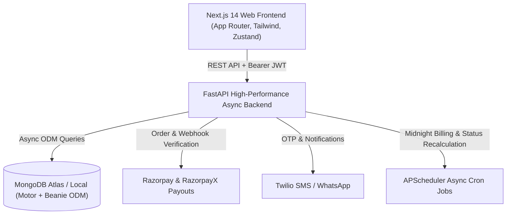

# FuelFlux Architecture Specification

## 1. System Overview

FuelFlux is an enterprise-grade SaaS platform purpose-built for fuel station networks, logistics fleet operators, fuel retail automation, employee attendance management, and corporate credit billing (Udhaar).

---

## 2. Architectural Layers

### Frontend Architecture (`frontend/`)
The frontend is built on **Next.js 14** with TypeScript and Tailwind CSS using the modern App Router architecture:
- **`app/`**: Next.js App Router containing route groups for distinct user roles:
  - `(auth)`: Login, registration, role selection, password recovery.
  - `admin/`: Superadmin operations (user management, station audits, revenue, risk, compliance).
  - `dashboard/`: Station owner / dealer portal (dispenser sales, tank telemetry, inventory, credit approvals, employee management, AI copilot).
  - `employee/`: Attendant / forecourt employee portal (shifts, attendance marking, salary slips, leave requests).
  - `investor/`: Financial portfolio, revenue shares, forecasting.
  - `logistic/`: Fleet operator credit management, vehicle fleet registration, digital fuel vouchers.
- **`components/`**: Modular, reusable UI components organized by domain:
  - `ui/`: Design system primitives (buttons, inputs, modal dialogs, cards, badges).
  - `layouts/`: App shells, responsive navigation sidebars, headers.
  - `admin/`, `compliance/`, `dashboard/`, `employee/`: Domain-specific components.
  - `feedback/`: Toast alerts, spinners, confirmation modals.
- **`services/`**: Centralized API abstraction layer with Axios interceptors managing token injection and refresh.
- **`stores/`**: Zustand client stores managing global state (`auth.store.ts`, `pumps.store.ts`, `wallet.store.ts`, etc.).
- **`lib/`**: Shared utilities, formatters, and HTTP clients.
- **`types/`**: Strict TypeScript interface declarations.

### Backend Architecture (`backend/`)
The backend is built on **Python 3.10+ FastAPI** with asynchronous MongoDB persistence via **Motor** and **Beanie ODM**:
- **`app/main.py`**: FastAPI application factory, CORS policies, static uploads mounting, life-cycle event handlers, and router registration.
- **`app/api/v1/`**: 34 domain-segregated REST route modules:
  - Core: `auth.py`, `admin.py`, `settings.py`, `dashboard.py`.
  - Fuel Operations: `pumps.py`, `sales.py`, `tank.py`, `inventory.py`, `hydrotesting.py`.
  - Credit & Corporate Billing: `udhaar.py`, `credit.py`, `invoice_api.py`.
  - Fleet & Logistics: `logistic.py`, `attendants.py`.
  - Human Resources: `employee.py`, `attendance_mgmt.py`, `leave_mgmt.py`, `salary_mgmt.py`, `shifts.py`, `announcements.py`.
  - Finance & Payments: `wallet.py`, `user_wallet.py`, `payment.py`, `accounting.py`, `subscriptions.py`, `admin_subscriptions.py`, `webhooks.py`.
  - Governance: `compliance.py`, `reconciliation.py`, `investor.py`, `events.py`, `reports.py`, `live.py`, `crm.py`.
- **`app/core/`**: Central configurations (`config.py` using Pydantic Settings), database life-cycle management (`database.py`), RBAC security dependencies (`dependencies.py`, `security.py`), and feature gating (`feature_gate.py`).
- **`app/db/models/`**: Beanie ODM Document models maintaining document validation, indexes, and relations.
- **`app/db/schemas/`**: Pydantic v2 validation models for request/response payloads.
- **`app/services/`**: Business logic implementations:
  - `wallet_service.py`: ACID double-entry balance updates and P2P transfers.
  - `razorpay_service.py`: Payment order creation, webhook verification, and simulated sandbox fallbacks.
  - `invoice_scheduler.py`: Background billing engine.
  - `sms_service.py`: Twilio SMS and fallback delivery.
  - `ocr_service.py`: Fuel receipt and meter reading OCR processing.
- **`scripts/`**: Administrative seed, setup, and maintenance CLI utilities.
- **`tests/`**: Integration and unit testing suite.
- **`src/`**: Backward-compatibility shim guaranteeing zero broken imports for legacy references.

---

## 3. Data Storage & Uploads (`data/`)
- `data/uploads/`: Centralized persistent directory for document attachments, logos, and receipts.
- `data/employees/`: Employee profiles and identity verification documents.
- `data/attendance/`: Attendance audit trails and verification logs.
